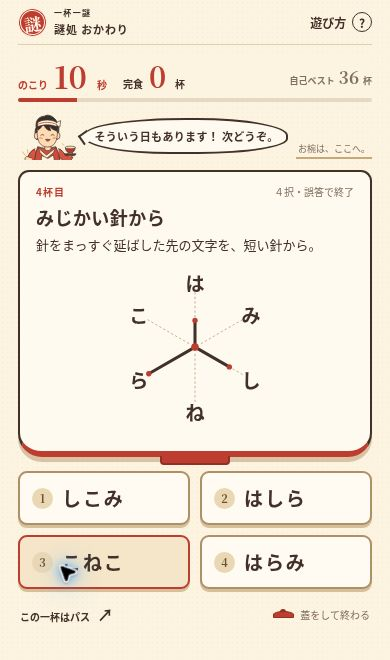
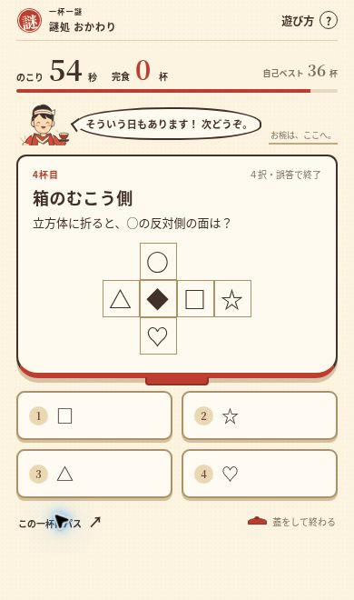
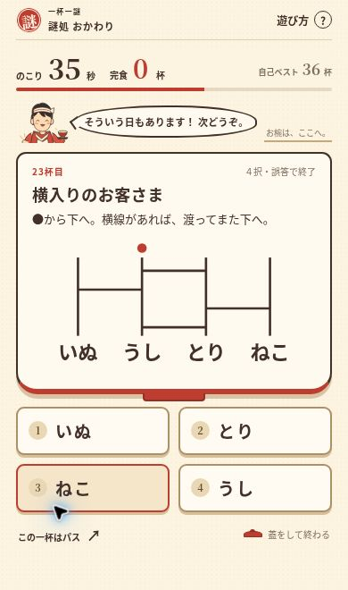
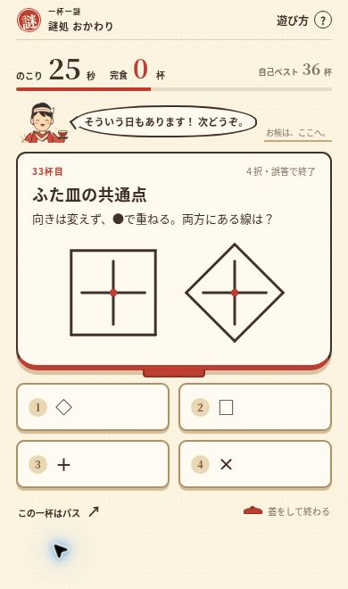

# 36問の品質レビューと改修記録（正解あり）

2026-10-26。対象は GitHub `main` の `ec8a4a05741ed247cdb161bd583748cabcc6e89c`。

## 結論と評価の範囲

既存36問を全件確認し、**維持18問／軽微な改善15問／差し替え候補3問（3問とも差し替え）**と判断した。総数は36問を維持する。

判断は、規則とデータを読む作問レビュー、独立した導出・状態遷移の検証、実ブラウザでの表示確認を分けて行う。表の秒数は改修後の**設計目標**であり、初見プレイヤーの実測ではない。「納得できる」「易しい」は作者による見積もりで、実測済みの事実ではない。

- 易：2〜4秒。中：5〜8秒。難：9〜15秒。
- 「一意」は指示された操作と４択の範囲。有限の例から、あらゆる人工的な別規則を排除したという意味ではない。
- 選択肢の抜け道は「強＝肝心の操作を省ける」「中＝一部の観察を省ける」「小＝主となる操作が必要」で評価する。改修後も語彙や消去法を完全に排除したとは主張しない。
- 「軽微」は仕組みの系統を保つ改善。大小・角数の問題では、順序を見ずに選べた欠点を直すため、文字素材と正答も変更する。

## 36問の評価一覧

「論理・一意」「選択肢」「重複」「納得・誤答」「量・秒数」「スマホ・文量」の各列で、依頼の9観点を扱う。秒数は改修後の目標、その他の指摘は原則として改修前の状態。

| # / 元の問題 | 判定 | 論理・一意性 | 選択肢だけの推測 | 既存問との重複 | 初見の納得・誤答の公平性 | 量・目標秒 | スマホ・文量 | 対応 |
| --- | --- | --- | --- | --- | --- | --- | --- | --- |
| 1 まんなか、いただきます | 維持 | ２例と３文字語の中央で定まる | 中。「こたえ」という語自体の誘引は残る | 両端問とは抽出位置が違う | 練習用として説明可能。特殊知識不要 | ３語、易2〜4秒 | ３行で読みやすい。指示は短い | 基礎となる中央抽出を残す |
| 2 たぬきのおしごと | 維持 | 例で「た」をすべて除くと明確 | 中。使われた文字で一部消去できる | 濁点除去とは単位が異なる | 「た抜き」を例が支える。語呂だけの要求ではない | ６文字、易2〜4秒 | １行。問題量は小さい | 既知形式の爽快な一杯として残す |
| 3 かえりの注文 | 維持 | ２例が逆順を指定する | 中。文字の種類でもかなり絞れる | 22と同一。こちらだけ残す | 入門問題として自然。逆順自体は難しくしない | ３文字、易2〜4秒 | 例と本体が分離して見える | 逆読みの代表として維持 |
| 4 てんてん、おやすみ | 維持 | 濁点を取る例と対象が対応 | 小〜中。「がらす」が操作前の候補になる | 23とは付加／除去の違いがある | 変化が見て分かり、誤答の理由も説明しやすい | ３文字、易2〜4秒 | 濁点も通常文字サイズで表示 | 対になる短い変化として維持 |
| 5 こごえの注文 | 維持 | 小書きだけ、読順と正規化も明示 | 中。使う文字を見つけるだけでも絞れる | 大小問とは小書き／字の寸法の違い | 「つ／っ」などの区別が必要。拡大設定は初見テスト課題 | ９マス中３文字、易2〜4秒 | ３×３、最小画面でも字を潰さない | 小書きの表記をそのまま残す |
| 6 一本、おあずかり | 維持 | 中央の点線だけを除くと口 | 小。選択肢がいずれも近い図形 | 漢字合成とは逆の操作 | 赤だけでなく点線と位置を指定している | １操作、易2〜4秒 | 大きなSVGで明快 | 漢字の一般的認識を使う暖機問題 |
| 7 おはしの道 | 維持 | 出発文字を読む指定と矢印で定まる | 中。最初の文字だけでは「すみれ」も残る | 33と同系だが、歩く形と長さが違う | 始点・１マス移動が明示されている | ２移動、中5〜8秒 | ３×３と矢印を同時に観察可能 | 基本の短い経路を維持 |
| 8 しるしのお品書き | 軽微な改善 | 各行の印と列の一致で定まる | 中→小。旧候補には表にない文字が多い | 表の行列対応は固有 | 印を無視した横読みを誤答として説明できる | ３行、中5〜8秒 | 見出し・行印も形で区別 | 誤答を横読みの「あひる／みかん／おやつ」へ変更 |
| 9 ふたりの共通点 | 維持 | 各組の共通文字が１つずつ | 中。最初の「き」だけでは絞り切れない | 新しい線の共通部分とは素材・観測が異なる | 指示が明快。文字比較の代表として残せる | ３組、中5〜8秒 | 各組を１行に分ける | 「同じ位置」問とは条件が違うことも残す |
| 10 一歩もどって | 維持 | 例と表で左へ１マスと分かる | 中。途中の変換を省いた読みは誤答になる | 表を使うが８の検索とは異なる | 五十音暗記を要求せず、必要な表がある | ３変換、中5〜8秒 | 表で高さを使う。短い画面は少量スクロールを許容 | 文字を縮める修正はしない |
| 11 上下、ぴったり | 軽微な改善 | 日を上、生を下に配置して星 | 小。近い漢字候補を比べる | 24と合成は同系、上下／左右の違いがある | 小学校範囲の形の認識。読む作業は少ない | １合成、易2〜4秒 | 部品は大きく固定方向 | 難度2→1。形・正答は維持 |
| 12 つなぎ目は、ひと口 | 維持 | 例と、単語間の１文字の一致で定まる | 中。語彙による先読みはできる | しりとりとは重複部を共有する規則が違う | 二重になった接続文字を１つにする体験を残す | ２接続、中5〜8秒 | 例１つと３枚。長い転記なし | 同じ語尾を単に消す問題にはしない |
| 13 ひと口おきに | 軽微な改善 | 例は最初から１つおき | 強→小。旧選択肢は文字の有無で正答を絞れた | ペア圧縮とは交互の２列がある点が違う | 開始位置を取り違えた誤答を説明できる | ８文字、中5〜8秒 | 不要な「→ ?」を省き１行に収める | 「たのしみ／かなしみ」を交互に配置。全候補を同じ文字集合から作る。難度3→2 |
| 14 しりとりの給仕列 | 維持 | あめ起点の３枚の接続順が一意 | 小〜中。カード語そのものも誤答候補 | 26と完全に同系。こちらだけ残す | 並べる→囲みを読む、の２段階を明示 | ３枚、難9〜15秒 | 囲みの線を維持。横並びを優先 | 一杯だけ、並べ替え型のしりとりを残す |
| 15 みじかい針から | 軽微な改善 | 長さの順と向きは一意だが、延長の推測が必要だった | 小。候補の文字はいずれも外周にある | 大小の順位づけとは向きの観察が異なる | 旧表示は方向を取り違える不公平があった | ３本、中5〜8秒 | ６方向の薄い補助線で判別を補助 | 延ばすと明記。全６方向に同じ補助線。正答「はしら」は維持。難度3→2 |
| 16 うつわの外にも | 軽微な改善 | 外だけを左から読むと定まる | 強→小。旧候補には存在しない文字があった | 小書き抽出とは所属を見る基準が違う | 「中か外か」という一つの観察で済む | ４文字、易2〜4秒 | お椀の内外を位置で表す | 全候補を画面にある文字から構成。難度3→1 |
| 17 まんなかのお品書き | 軽微な改善 | 縦３列に３語が成立し、中央を選ぶ | 小〜中。左右の語も候補で、縦を見る必要がある | 中央抽出とは読む単位が「語」に変わる | 横読みから縦読みへの転換を残す | ３×３、中5〜8秒 | 中央列だけを色で教えない | 画面にない文字の「つばめ」を「したく」へ。難度3→2 |
| 18 ひとりのお客さま | 維持 | ２回ずつの３種類を除き、残りが一意 | 小〜中。候補の文字がどれも表にある | 30と完全に同じ。こちらだけ残す | ２回ある文字を両方除くと明記 | ９マス、難9〜15秒 | ３×３。作業量はこの形式を１問に抑える | 頻度を観察する代表として維持 |
| 19 はしから、ぱくり | 維持 | ２例から最初と最後を読む | 中。２文字なので選択の負担は小さい | 中央抽出と対照的な位置を見る | 読み順も通常の左→右で納得できる | ３文字、易2〜4秒 | 例２つでも短い | 「両はし」に気づく一杯を残す |
| 20 ふたくちで、ひと文字 | 維持 | 隣り合うペアを１文字にする | 中。普通の語を推測できる部分はある | 18の両方除去とは結果も基準も違う | 例と「ふたりずつ」が規則を支える | ３ペア、易2〜4秒 | ６文字の１行。囲みの追加は不要 | 圧縮と全除去を混同させない説明を維持 |
| 21 大きなお客さまから | 軽微な改善 | 順位は一意だったが、順序を見る必要がなかった | 強→小。旧候補で３文字を全部使うのは正答だけ | 角数とは観測する量が違う | 全候補が同じ文字なら、寸法比較の意味が生まれる | ４文字、中5〜8秒 | 48/38/28/20pxを明確に区別 | 「かんせい／かいせん／せんかい／せいかん」に変更。難度1→2 |
| 22 もどって読めば | 差し替え候補→実施 | 成立はする | 中。語彙で正答を予測しやすい | ３と例・手順まで同じ | ２回目の逆読みには新しい発見が乏しい | 新問は１比較、易2〜4秒 | 新問は２つの同寸SVG | 「ふた皿の共通点」へ。向きを変えず●を合わせ、共通する線の形を選ぶ |
| 23 てんてん、おいで | 維持 | 濁点を付けられる文字だけに付加 | 小〜中。操作前の「はら」も候補 | ４とは操作方向の違いがある | 「ら」に無理な濁点を付けないと明記 | ２文字、易2〜4秒 | 例と文字が大きい | 対になる付加の問題として残す |
| 24 左右、ぴったり | 軽微な改善 | 日と月の配置から明 | 強→小。林・休は部品だけで除けた | 11と方向が違う合成 | 右側まで見る比較にすると納得できる | １合成、易2〜4秒 | 漢字４択は大きさを維持 | 「明／朋／時／暗」へ変更。各誤答にも日か月がある |
| 25 鏡の向こうの注文 | 軽微な改善 | 縦の折り目を軸とした左右対応で一意 | 中→小。旧候補１つに表にない「か」があった | 鏡映しはこの１問だけ | 「向かい側」が文字自体の鏡文字と取られる懸念があった | ３対応、難9〜15秒 | 折り目ラベルを追加し、丸印のマスを維持 | 「○と重なるマス」と明記。「かがみ」→「つみき」。難度2→3 |
| 26 しりとり、もう一列 | 差し替え候補→実施 | 成立はする | 中。最後の字を３枚拾う構造 | 14と接続・抽出手順が同じ | 語を変えただけでは別の気持ちよさが弱い | 新問は６面、難9〜15秒 | 新問は６マスの展開図だけ | 「箱のむこう側」へ。折った後に向かい合う面を選ぶ。難度2→3 |
| 27 かどのあるお客さま | 軽微な改善 | ４・３・０の降順が一意 | 強→小。旧候補で３文字全部を使うのは正答だけ | 寸法順とは角の数に注目する差がある | 少ない順の「がいか」が自然な誤答になる | ３図形、易2〜4秒 | 三角・四角・丸の中の字を維持 | 文字を「か・い・が」へ。全４候補を同じ３文字の語に。難度2→1 |
| 28 上下、ひとくちずつ | 維持 | 上始まり・一文字ずつ交互と指定 | 中。にわとりという語の補完は可能 | 13とは２本の列を編む操作が違う | 読み方の指定が十分で誤答の理由も明瞭 | ２×２文字、中5〜8秒 | 上下の位置を固定して表示 | 単なる逆読みにはせず、交互読みを維持 |
| 29 ３つの穴は、同じ味 | 軽微な改善 | かま・かく・かみの３条件が一致 | 中。最初の語だけで答えは絞れる | 語彙を使う穴埋めはこの１問だけ | 説明は日常語で、検索を求めない | ３つの短語、易2〜4秒 | １行ずつ。長文にはしない | 補助的な易問と評価し、難度2→1 |
| 30 ふたり組は、退席 | 差し替え候補→実施 | 成立はする | 中。削除後の普通の語を補完できる | 18と頻度除外・読順が同じ | ９文字の同じ確認作業を繰り返す理由が薄い | 新問は２回の横移動、中5〜8秒 | 新問は４本の線と２文字語 | 「横入りのお客さま」へ。接続している横線だけを渡る |
| 31 四すみのお席 | 軽微な改善 | 左上始まり・時計回り・四隅で一意 | 中。最初の「た」だけでは複数候補が残る | 経路問とは飛ばす場所が指定される差がある | 始点と向きがともに観測できる | ４隅、中5〜8秒 | 中央の字を隠さない既存表示を維持 | 難度3→2。読順・正答は維持 |
| 32 同じ席で、待ち合わせ | 維持 | 各組で同位置の共通文字が１つずつ | 中。１文字目「あ」だけでは定まらない | ９の「位置不問」と異なる条件 | 別位置の共通文字があるため、位置を見る意味がある | ３組、難9〜15秒 | 等幅の文字枠で比較。文字を縮めない | 通常の共通文字問題の上位として維持 |
| 33 くるり、折り返し | 軽微な改善 | ２×２を矢印どおりに移動する | 中。最初の「とも」でも複数候補が残る | ７とは回り込む形で違いがある | １マス移動と始点が明示されている | ３移動、中5〜8秒 | 小さな表。操作は不要 | 難度3→2。長い経路にはしない |
| 34 ふたりだけ、席替え | 軽微な改善 | 丸の２文字を交換し、中央を保持 | 中。素材の字だけでは「いるか」も残る | 逆読みとは指定した２文字だけを動かす差がある | ３文字では結果が逆順と同じになるが、丸印による限定を学ぶ短問 | １交換、易2〜4秒 | 大きい３文字で押し間違いと無関係 | 難度3→1。今後の同型追加は避ける |
| 35 しりとりの空席 | 軽微な改善 | 前後の接続を満たす語は１つ | 強→小。旧候補では末尾「だ」だけで正答が出た | 14の並べ替えではなく、接続条件の照合 | ４択を全て３文字の動物へ揃える | ２条件、易2〜4秒 | 前・空席・後の１行 | 「らっぱ」→「ぱんだ」。前だけ２候補、後だけ２候補に。難度3→1 |
| 36 穴あきのお品書き | 維持 | 同寸の表と紙・読順の指定で一意 | 小。全候補が同じ表の文字からできる | 新しい共通線は集合の交差で、こちらはマスク抽出 | 穴の位置が全て見え、一瞬の演出に依存しない | ４つの穴、難9〜15秒 | 左右のマスの大きさを一致させている | 手作業で紙を重ねる操作は追加しない |

## 差し替えた３問の具体設計

### もどって読めば → ふた皿の共通点

- 逆順問は「かえりの注文」を残す。
- 新問は、四角の枠とひし形の枠を描いた２枚の図。それぞれの中心の●を合わせ、向きを変えずに重ねる。
- 両方に共通する**線分**は、中心で交わる縦線と横線だけ。正答は `＋`。
- 誤答の `□` と `◇` は片方の枠だけを見た解釈。`×` は縦横ではなく斜めの線を拾った場合の誤答候補。
- 共通文字問と「共通するもの」という抽象的関係は共有するが、同じ文字の探索ではなく図形の重ね合わせを扱う。
- 実装は新しい小さなSVG描画。線分の正本を問題データに置き、表示も独立検証もその幾何データから行う。

### ふたり組は、退席 → 横入りのお客さま

- 頻度による除外は「ひとりのお客さま」だけにする。
- 新問は４本の縦線。上の●から下へ進み、自分の線につながった横線に出会ったときだけ隣へ渡る。
- 開始は２列目。上から、2–3、1–2、3–4、2–3列を結ぶ横線。経路は2→3→4列目。正答は `ねこ`。
- `うし` は横線を渡らない場合、`とり` は１回だけ渡る場合。`いぬ` は出発列や渡る向きを誤った場合の候補。
- あみだくじを知っていることは前提にせず、横線を必ず渡るルールを問題文に書く。操作を追加せず、視線だけで短く辿れる量にする。

### しりとり、もう一列 → 箱のむこう側

- ３枚の並べ替えしりとりは「しりとりの給仕列」を残す。
- 新問は６面の展開図。横一列が `△・◆・□・☆`、◆の上が○、下が♡。
- 立方体に折ると、○の反対の面は `♡`。△・□は隣接面。☆は基準を◆と誤ったときの反対面。
- ４択の印は全て図中にあるため、印の有無だけでは答えを選べない。
- 新たなドラッグや回転操作は要求しない。折る前の２次元の隣接と、折った後の面の関係を捉え直す一杯。
- 立体把握が苦手な人には15秒を超える可能性がある。難として少なめに混ぜ、パスを維持する。初見テストで不適合なら、この一問は再検討する。

## 改善した選択肢と観察

- 左右、ぴったり：明／朋／時／暗。日・月の種類だけでなく、右側の部品まで比較する。
- 大きなお客さまから：全候補が「か・ん・せ・い」を１回ずつ使う。語彙だけで順位観察を省けないようにする。
- かどのあるお客さま：かいが／かがい／いかが／がいか。全候補が同じ３文字。降順と昇順も候補で区別する。
- ひと口おきに：２文字目から読むと、実際に選択肢の「かなしみ」になる。開始位置を確かめる意味がある。
- しるしのお品書き：印を無視した横読みも、実際に候補の語になる。
- うつわの外にも：４候補は全て内外に見えている文字から作る。外だけか、中も混ぜたかを比べる。
- まんなかのお品書き：３列とも候補に残し、４つ目も表にある文字から作る。
- 鏡の向こうの注文：折り目を表示し、「○と重なるマス」を読むと指定。文字自体を鏡文字に変える規則ではない。
- しりとりの空席：前の語だけなら「らくだ／らっこ」、後ろの語だけなら「らくだ／ぱんだ」。両方でらくだ１つになる。
- みじかい針から：答えの３方向だけでなく、**全６方向**へ同じ薄い点線を描く。必要なのは実線の３本を長さ順に読むことで、点線だけでは針の選択も順番も決まらない。

## 難度と出題方法

改修前は易12・中12・難12。改修後は**易17・中13・難6**。時間のかかる文字比較・関係の再構成を難とし、短い直接観察を易〜中へ移す。難度を均等数にするために易問を難と呼ぶことはしない。

| 問題 | 旧→新 | 根拠 |
| --- | --- | --- |
| 上下、ぴったり | 中→易 | １回の漢字合成 |
| ひと口おきに | 難→中 | 例の規則１つで完結 |
| みじかい針から | 難→中 | 延長を明示し、視認の負担を減らす |
| うつわの外にも | 難→易 | 内外の１条件で直接読む |
| まんなかのお品書き | 難→中 | 縦読みの発見後は中央を選ぶだけ |
| 大きなお客さまから | 易→中 | ４文字の順位を実際に比較する問題へ改善 |
| 鏡の向こうの注文 | 中→難 | ３か所の左右対応を観察する |
| しりとり、もう一列→箱のむこう側 | 中→難 | 異なる空間把握の問題へ差し替え |
| かどのあるお客さま | 中→易 | ３つの単純図形の角数を見る |
| ３つの穴は、同じ味 | 中→易 | 日常の短語、１文字の照合 |
| 四すみのお席 | 難→中 | 始点と向きが明示された４点 |
| くるり、折り返し | 難→中 | 小さい２×２の３移動 |
| ふたりだけ、席替え | 難→易 | 両端２文字だけの１交換 |
| しりとりの空席 | 難→易 | 前後２文字の短い条件照合 |

旧balancedは、各難度から１問ずつ取り出していた。17/13/6問のまま適用すると、18問で難が全て尽き、後半に難が出なくなる。

改修では、各難度内をシャッフルし、その難度のn問目のランダムな位置を**一巡全体に均等な区間**へ割り当ててから混ぜる。各問は一巡に１度ずつ。難度の数が等しいときは以前と同じく３問単位で３難度が混ざる。数が異なるときは数に応じて全体へ散る。無理に難を重複させたり、特定問を隠したりしない。

これは競技用の難度均等化ではない。同じ60秒でも、解く速さ・パス・出題された問題で記録は変わる。既存ベストを保存する要件を優先し、記録のリセットは行わない。

## 検証

### 独立したコードで確認すること

`node tests/verify.cjs`：

- 全36問の構造データから正答を導き、各４択の正答が１つであることを検査。
- 36×４＝144の選択結果。正答36通りは次へ、誤答108通りは即終了し加点しない。
- 新問の線分の重なりを計算。交差する点だけは「共通の線」と数えず、長さがある重複だけを扱う。
- 横線の接続を順に辿り、４つの到達先のうち正答が１つであることを計算。
- 展開図の各面を３次元の面方向へ折り、６面が異なる方向に対応し、対象面の反対が１つであることを確認。
- 大小・角数の候補が同じ文字の並べ替えであること、しりとりの前後それぞれが２候補を残すことを検査。
- ２方式×300回の出題、１巡の重複、巡の境界、難度数が異なる際の分散、同数時の３問ブロック。
- 60秒ちょうどの入力拒否、パス、蓋、古いボタン番号、誤答前の得点、保存破損・保存失敗、60/90秒の別記録。
- 全問に描画があり、針の図は６方向の補助線と３本の実線を持つことを検査。

結果・実ブラウザの確認範囲は `tests/quality-browser-verification.json` に記録する。表示の実測値は `tests/quality-layout-measurements.json` を参照。

### 今回の実行結果

- 全36問×４サイズ（320×568、390×660、844×390、1280×900）を実ブラウザで表示。各サイズで１巡36問に重複なし。２つの縦画面では36問全てを正解ボタンから回答し、即座の次問移行と36杯を確認。横向きとPCはパスで１巡し、加点されないことを確認。
- 全144表示で、図を描く子要素まで問題枠内、問題文・図・４択に重なりなし、横はみ出しなし。
- 320×568の４択は最大y=498、終了操作は最大y=542。390×660では従来の「一歩もどって」の終了操作がy=661に達するため、わずかな縦スクロールを許容する。
- 誤答で即終了、誤答前の３杯を保持、低記録で自己ベスト36杯を上書きしない、リロード後も36杯を表示することを確認。
- PC数字キー、古いボタンの再発火、キー長押し、リトライの60秒、蓋の２回操作、時間切れ後のボタン無効化、破損データからの開始を確認。
- 結果画面で「まだ一杯ありますよ？」と未実装の案内が残ることを確認。
- レイアウト測定の動きを減らす設定は初期化前に模擬。通常の動きでも針・差し替え３問を目視して撮影した。実機Safariの検証ではない。

### 数学的検証と分けること

漢字・単語の自然さ、図の意味がすぐ伝わるか、誤答時に納得できるか、何秒かかるか、もう一回遊びたくなるかは、全探索や正誤判定だけでは証明できない。現在は制作者による内容レビューとブラウザ上の動作確認で、初見プレイヤーテストは未実施。

## 未解決点と次のテスト

1. 展開図の一杯は空間把握の個人差が大きい。３〜５人程度の初見で、15秒以内の解答・パス率を測る。長ければ難問を増やす理由にはせず、この１問を差し替える。
2. 逆順・た抜き・中央抽出などには、語彙から先読みできる余地が残る。入門用の短問として維持した。すべてを難しい候補へ変更するとテンポを損なうため、今回一律には変えていない。
3. 「ふたりだけ、席替え」は３文字なので結果が逆順とも一致する。限定交換を別形式として残したが、今後この型は増やさない。
4. 針の方向、丸と小書き、展開図の見やすさは実機Safariでも確認したい。エミュレートした画面幅だけで実機確認済みとは扱わない。
5. 誤答即終了のため、初見テストでは正答率だけでなく「分かっていたのに図・文言のせいで押し違えた」を優先して拾う。

## 90問へ向けた提案

- 同じルールで素材だけ変えた問題を数合わせで増やさず、観察対象（文字の位置・形・接続・視点・意味）の一覧を先に作る。
- 新しい１問ごとに、誤った操作で何の候補になるかも記録する。正答だけが普通の言葉、必要な文字を全部含むのが正答だけ、という抜け道を先に確認する。
- 60秒・即ドボンのまま、小さい試遊セットで目標秒数と誤答理由を測り、分類を修正してから本体へ追加する。
- 難度ごとの数を揃えるために分類を曲げない。今回のbalancedは個数が異なる場合も扱える。
- 視認性の理由で難しくなった問題は難問として残さず、表示を直す。
- おまけの一杯は通常90問の外で独立して制作し、通常得点・シャッフル・保存には混ぜない。

## ブランチと保護範囲

専用ブランチ `quality/review-36-puzzles-20261026`。mainへの反映・本番公開は行わない。

`dist/config.js` はbalancedの説明コメントだけを更新し、60秒・保存キー・お給仕さんの掛け声など全設定値を保持する。`dist/app.js`（即ドボン・即次問・パス・蓋・保存・演出）と `dist/extra-bowl.js` は変更しない。ゲーム側の状態計算の変更は、難度の数に対応する出題キューだけ。新問のための描画を追加する。既存の隠し要素の入口はそのまま残す。
